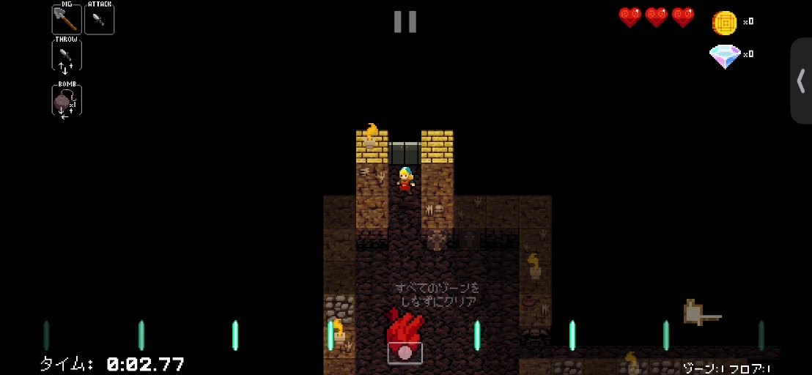
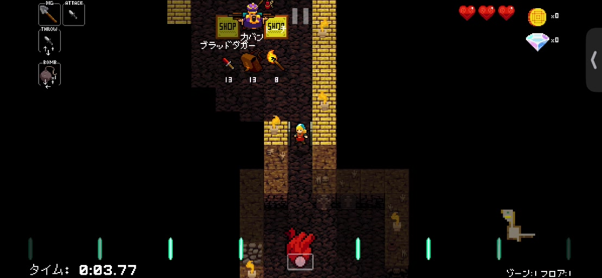

# 追加動画: 見えない金壁と鉄扉の分析

対象: `ScreenRecording_11-05-2026 12-41-49_1.mp4`。約171.8秒、1108×512、30fps。すでに横向きのため回転・縦伸ばしをしない。ファイル識別・ハッシュと代表フレームは [manifest](../analysis/manual-video-2/source_manifest.json) に記録。

## 確認方法と限界

全編を約1秒間隔で目視し、鉄扉の接近・開扉部分を約0.2秒間隔で追加確認した。金壁が初期に見えない例は独立担当が原動画のPTSで細分確認した。[事例と根拠](../analysis/manual-video-2/hidden-shop-patterns.md) と [ケース台帳](../analysis/manual-video-2/hidden-shop-cases.json) を参照。

1fpsの一覧ラベルは検索用の概数で、正確な発生時刻ではない。代表画像は原動画フレーム番号で抽出する。指のタップは映っていないため、入力回数・押下時間・コマンド送信時刻はこの動画から確定しない。

## 初版への適用範囲

最新のユーザー指示により、初版は開幕に金壁が見える回だけを採用し、見えない回は探索せず高速周回する。以下の隠れた店の分析は将来拡張用の資料。初版では非可視例を「開幕対象外」として見送ることが正しい動作であり、店がないという判定ではない。

## 金壁が最初に見えない配置

今回の動画は「金壁なし」と早期終了してよいことの証拠ではない。開始時に金色が見えなくても、数歩の移動で画面外/未観測領域が開け、近くの店が判明する例を含む。

- 初期画像、金壁が見える画像、商品の見える画像を同じランとして対応づける。
- 部屋の形、通路の口、観測境界を初期特徴として記録する。後で判明した店の位置を初期判定へ漏らさない。
- 上の通路へ近づく例、左寄りへ回って上へ進む例、左への横入口へ回る例を区別する。
- ミニマップは小さいため、今回の画像だけで店を断定する特徴にはしない。
- 似た地形で近くに店がない例が十分ない。6例から全配置の規則や見落とし率は推定しない。

将来の探索機能への設計案は「金色の有無の二択」から、観測済みの床と未観測の出口に基づく短い局所探索への変更。探索方向の優先度は現在の地形で決める。時間・歩数の上限を設け、上限到達を店なしと同義にしない。

今回保存するのはパターンの観察結果、ラベルと回帰ケースであり、実行プログラムの分類器を訓練・配布したわけではない。学習に利用したランを未知評価用として再利用しない。

## 鉄扉の時系列

動画の約113〜117秒では、上の通路の灰色の両開き扉へ接近し、扉が開いて商品が見える。代表画像は114.8秒の閉扉、115.4秒の接近、116.0秒の開扉後の部分表示、116.4秒の商品表示。

この系列は、以前の鉄扉1枚だけでは不足していた「閉扉→接近→開扉→商品可視」の正例になる。上方向への接近と開扉は画面から確認できるが、必要な入力回数や押し続け時間は別途実機で測る。木扉と同一の入力回数と決めつけない。

## 追加する検証条件

| 条件 | 検証したい動作 |
| --- | --- |
| 開幕に金壁がない近隣店 | 初版は探索せず開幕対象外として見送る。将来拡張時は探索の回帰ケース |
| 上/左/下方向の店 | 上方向固定の移動にしない |
| 鉄扉とHUDポーズ記号の重なり | 扉の灰色とポーズの灰色を混同しない |
| 開扉直後に商品が一部だけ出る | 商品全体の否定を早まらない |
| 下の店の商品が画面端/HUDに隠れる | 可視性を評価し、必要なら観測位置を調整 |
| 一時ポーズを挟んで同じランを続行 | 新しいランと誤計数しない。所要時間からポーズを区別 |
| 普通の短い黒画面 | ロード遷移と取得異常を状態・期限で分ける |
| 録画最後のコントロールセンター | 古いゲーム画像で入力を続けない |

対象の指輪の確実な正例はまだ固定していない。この動画の閲覧だけで対象検出が完成したとはしない。速度の精密比較には入力時刻付きの実機計測が必要。

## 2026-11-06 ビート観測動画

追加資料`ScreenRecording_11-06-2026 11-26-58_1.mp4`、8,438,584bytes、SHA256 `11c12501da8f25b404aba9ef2dd4cfd90e5be0d52867b175690d0f9e6fde4a63`。1108×512、回転なし、30fps、606フレーム/20.2秒。開始はポーズ、末尾はコントロールセンターへの遷移で、安定したゲーム表示1.0〜18.9秒の538フレームを計測対象にした。索引用1fps画像の時刻は丸めではなく抽出規則によってずれるため、下記は元動画のPTSを使用する。

原寸HUDの緑バーの左右対称位置と間隔を抽出し、位相を連続化して時間へ線形回帰。バー間隔中央値129px、中心中央値550.75px、周期0.521755秒（114.996 BPM）、位相残差RMS0.015649周期。実用上は**約0.522秒/拍、約115 BPM**とする。録画開始から約1.381、1.903、2.425、2.946秒が、バーが中心へ合流する推定時刻の例。フレーム間隔は約0.0333秒で、タッチ時刻や端末入力遅延の測定精度を意味しない。

既存`beat_sync.extract/fit`との比較に限り、オフラインで896×414へ最近傍縮小した。8枚のframe差分`[0,23,48,70,94,120,142,165]`、開始frame`30,90,150,210,270,330,390`の7区間で全てfitが成立し、周期0.520206〜0.523782秒。これは既知動画への当てはまりであり、別の未知評価集合でも端末HTTP時刻でもない。**実行コードへのリサイズ・回転は追加していない。**

安定区間で地形の1マス変位や入力印は確認できず、末尾はOS画面への遷移と重なる。この動画から「拍の前後何秒まで入力が受け付けられるか」「移動入力が何秒で反映されるか」は確定できない。周期を使って次の拍を予測する一方、ラン/ポーズ復帰ごとにライブHUDで起点を取り直す。150ms先行は未校正のまま明示し、実機の一歩と変位・商品可視を次の受入条件にする。生動画・フレーム・解析JSONはGitへ追加しない。
